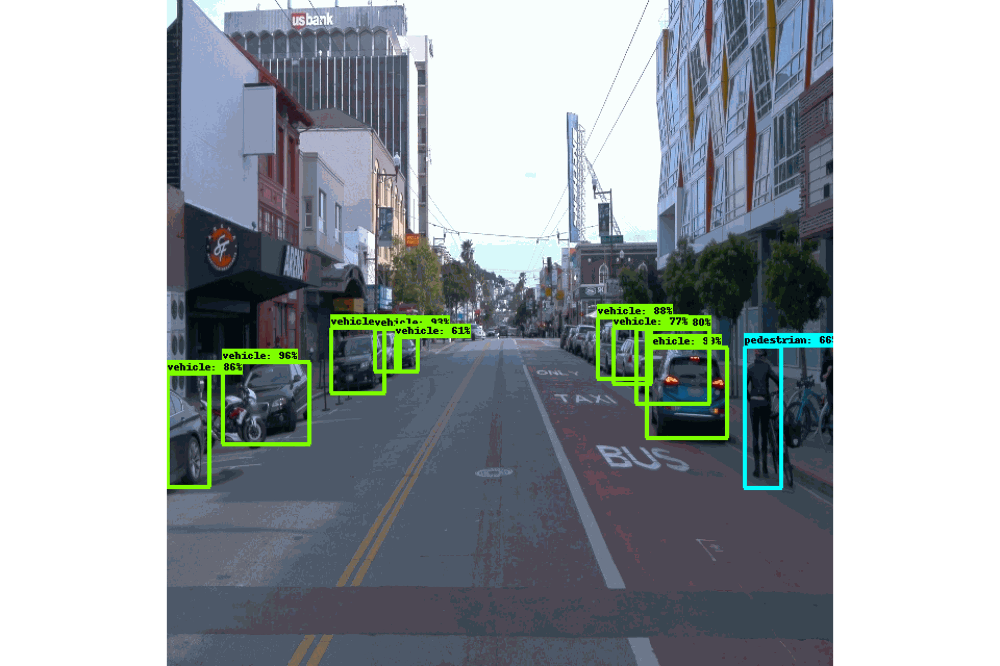

# Object detection in an urban environment

In this project, you will learn how to train an object detection model using the [Tensorflow Object Detection API](https://tensorflow-object-detection-api-tutorial.readthedocs.io/en/latest/index.html) and [AWS Sagemaker](https://aws.amazon.com/sagemaker/). At the end of this project, you will be able to generate videos such as the one below. 

<p align="center">
    
</p>

## Installation

Refer to the runbook below, then to the **Setup Instructions** page in the classroom to setup the Sagemaker Notebook instance required for this project.

>Note: The `conda_tensorflow2_p310` kernel contains most of the required packages for this project. The notebooks contain lines for manual installation when required.

## Usage

This fork compares three pretrained candidates under one shared training recipe and deploys the best one.
The vocabulary is defined in [GLOSSARY.md](GLOSSARY.md), and two decisions that are easy to undo by mistake are recorded in [docs/adr](docs/adr).

| Notebook | Purpose |
|---|---|
| [1_train_model_efficientdet_d1](1_model_training/1_train_model_efficientdet_d1.ipynb) | Run 1: EfficientDet D1 (baseline). It also builds the shared Docker image. |
| [1_train_model_ssd_mobilenet_v2_fpnlite_640](1_model_training/1_train_model_ssd_mobilenet_v2_fpnlite_640.ipynb) | Run 2: SSD MobileNet V2 FPNLite 640 |
| [1_train_model_ssd_resnet50_v1_fpn_640](1_model_training/1_train_model_ssd_resnet50_v1_fpn_640.ipynb) | Run 3: SSD ResNet50 V1 FPN 640 (RetinaNet50) |
| [3_experiment_summary](1_model_training/3_experiment_summary.ipynb) | Comparison table, TensorBoard graphs, Best model, write-up (TODO 2) |
| [2_deploy_model](2_run_inference/2_deploy_model.ipynb) | Deploys the Best model and generates `output.avi` (TODO 3) |

Each candidate's config is in `1_model_training/configs/<candidate>/pipeline.config`.

### Runbook (SageMaker)

1. **Notebook instance:** use `ml.t3.xlarge` with a 50 GB volume. It needs no GPU: training and inference each run on their own instances.
   First check in Service Quotas that you have at least 1 of each of these:
   * `ml.t3.xlarge` for notebook instance usage
   * `ml.g5.xlarge` for training job usage
   * `ml.g4dn.xlarge` for endpoint usage
   Clone **this** repository, not the Udacity one.
2. Run `1_train_model_efficientdet_d1.ipynb` from top to bottom. Restart the kernel after the install cell. This builds and pushes the Docker image once, which takes about 10 to 20 minutes.
3. Check the first Run before you spend more:
   * its loss should go down without any NaN;
   * note how long training took, from `results/efficientdet_d1.json`.
   If training took far more than about 1 hour, lower `num_steps` and `total_steps` (with warm-up at 10%) in **all three** configs before the next Run. `tests/` checks that the configs still agree.
4. Run the two SSD notebooks, one after the other: only one training job at a time, because of the concurrency limit.
5. Run `3_experiment_summary.ipynb`. It writes `results/summary.csv` and `results/best_model.json`. Then fill in the write-up.
6. Run `2_deploy_model.ipynb`, download `output.avi`, then **run the last cell, which deletes the endpoint**, and check under Inference > Endpoints that it is gone.
7. Commit the executed notebooks and `results/`. Then **stop** the notebook instance, and delete it once your work is backed up.

### Local checks

```bash
uv run --no-project --with pytest --with protobuf --with tensorboard --with pandas --with setuptools python -m pytest -q tests -p no:asyncio
```

The tests parse every `pipeline.config` against the OD API protos (vendored in `tools/od_protos`) and check that the shared recipe is identical across candidates.
They also check that the training notebooks match `tools/make_training_notebooks.py` and that the notebook helpers behave correctly.
After you edit the template, regenerate the notebooks with `python3 tools/make_training_notebooks.py`.

## Troubleshooting

**SageMaker SDK errors** (for example `No module named 'sagemaker.estimator'`, `module 'sagemaker' has no attribute 'get_execution_role'` or `No module named 'sagemaker.train'`)

The notebooks use the SageMaker Python SDK **v3** (`ModelTrainer` for training, and the `Model`, `EndpointConfig` and `Endpoint` resources from `sagemaker.core` for deployment). They need Python 3.10 or later (the default `conda_python3` kernel on SageMaker notebook instances). Run the install cell at the top of the notebook, restart the kernel (**Kernel > Restart**), and run the notebook from the top again. The version check cell must print a version that starts with `3.`.

`No module named 'sagemaker.estimator'` or `TensorFlowModel` errors mean that you are running an older copy of the notebooks, written for SDK v2. Run `git pull` in the repository folder to get the latest version.

**S3 `AccessDenied` when launching the training job**

`tensorboard_s3_prefix` must point to a bucket in your own AWS account. By default the notebook uses your SageMaker default bucket.

**Deployment fails or doesn't finish**

`2_deploy_model.ipynb` creates its own endpoint on an `ml.g4dn.xlarge` instance, which usually takes 5 to 15 minutes. If it fails or times out:
* check that `model_artifact` is the full S3 path of the `model.tar.gz` produced by a **Completed** training job
* check that your quota for `ml.g4dn.xlarge for endpoint usage` is at least 1 (**Service Quotas > Amazon SageMaker** in the AWS console)
* read the failure reason under **Inference > Endpoints** and the CloudWatch logs of the endpoint

Delete the failed endpoint, as well as its endpoint configuration and model, before you try again.

**Remember to delete your endpoint** when you are done (last cell of `2_deploy_model.ipynb`). Endpoints are billed for every hour they run.

## Useful links
* The Tensorflow Object Detection API tutorial is a great resource to debug your code. This [section](https://tensorflow-object-detection-api-tutorial.readthedocs.io/en/latest/training.html#configure-the-training-pipeline) in particular will teach you how to edit the `pipeline.config` file to update
your training job.

* [This blog post](https://aws.amazon.com/blogs/machine-learning/training-and-deploying-models-using-tensorflow-2-with-the-object-detection-api-on-amazon-sagemaker/) teaches how to label data, train and deploy a model with the Tensorflow Object Detection API and AWS Sagemaker.
